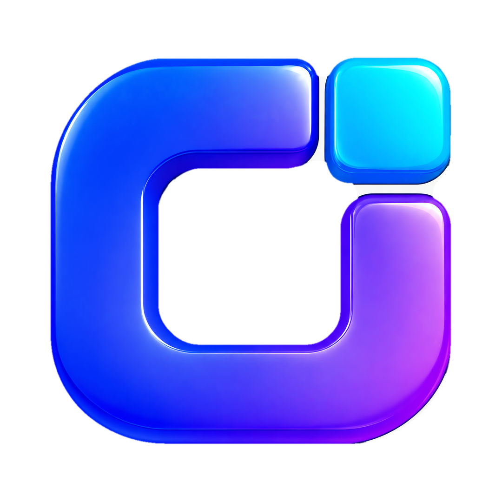
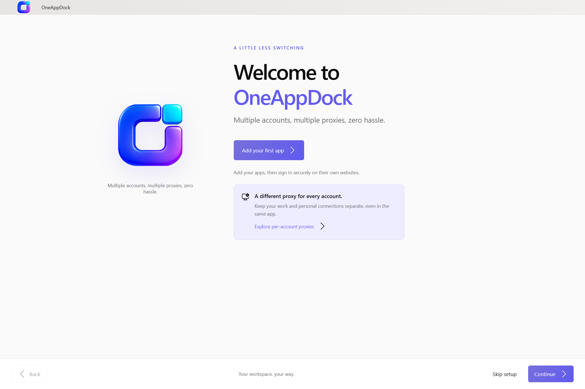
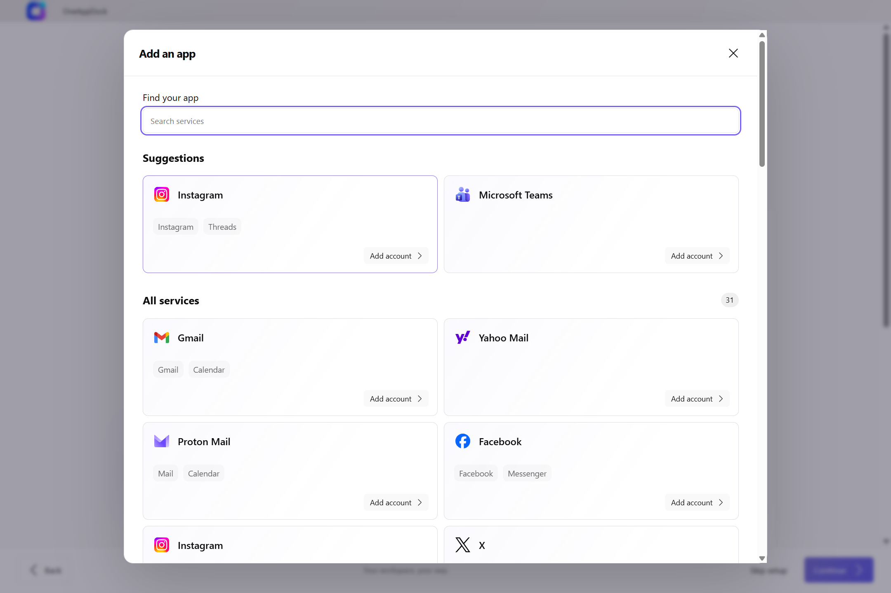
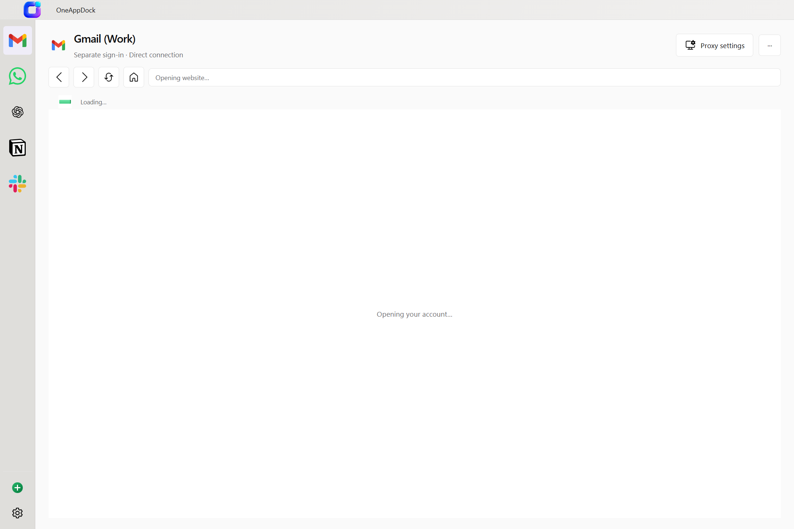
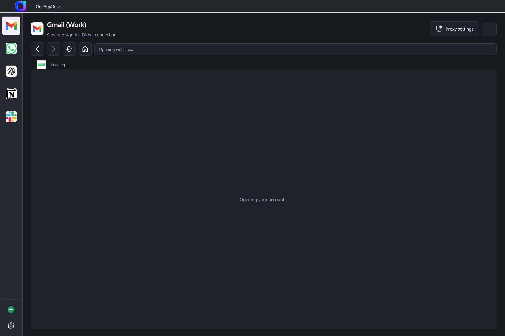

# OneAppDock

### All Your Apps. One Dock.
**Multiple accounts, multiple proxies, zero hassle.**

[-0078D6?style=for-the-badge&logo=windows&logoColor=white)](https://github.com/sadiqtbh/OneAppDock-Windows-Version/releases)

 

[**Download Installer (.exe)**](https://github.com/sadiqtbh/OneAppDock-Windows-Version/releases/download/v1.3.2/OneAppDock-Setup-1.3.2-x64.exe) &nbsp;•&nbsp; [**Download Portable (.exe)**](https://github.com/sadiqtbh/OneAppDock-Windows-Version/releases/download/v1.3.2/OneAppDock.exe) &nbsp;•&nbsp; [**Download Source Code (.zip)**](https://github.com/sadiqtbh/OneAppDock-Windows-Version/releases/download/v1.3.2/OneAppDock-GitHub-Source-1.3.2.zip) &nbsp;•&nbsp; [**Official Website**](https://www.oneappdock.com/)

---

## 🌟 Overview

**OneAppDock** is a modern, high-performance desktop workspace for Windows that consolidates all your web applications, communication tools, and multi-account services into a single clean interface. 

Stop switching between dozens of messy browser tabs and separate browser profiles. With OneAppDock, each app runs in its own isolated environment with dedicated proxy configurations, custom themes, and paired service tabs.

---

## 📸 Screenshots & Visual Tour

### Welcome & Setup Experience
*A smooth onboarding flow designed to get your workspace running in seconds.*

  

### 31+ Preconfigured Services & Custom URLs
*Instantly add popular web applications or link any custom website with custom icons.*

  

### Workspace with Top & Left Navigation
*Switch between top-rail or left-rail layouts with customizable accent colors.*

| Top Navigation Layout | Left Navigation Layout |
|:---:|:---:|
|  |  |

 

### Native Dark Mode & Personalization
*Tailor the look and feel to your setup with automatic system theme synchronization or high-contrast dark mode.*

---

## ✨ Key Features

- 👥 **Multiple Isolated Accounts**: Add multiple accounts for the same service (e.g. personal Gmail, work Gmail, client WhatsApp). Cookies, sessions, and storage remain strictly separated.
- 🛡️ **Per-Account Proxy Routing**: Configure independent HTTP, HTTPS, or SOCKS5 proxies per account. No traffic leaks — if a proxy fails, OneAppDock never silently falls back to direct unproxied connections.
- 🔐 **Hardware-Grade Credential Protection**: Sensitive proxy passwords and access keys are encrypted using Windows Data Protection API (DPAPI).
- 🧩 **Paired Service Tabs & Split View**: Group companion services together (e.g. Facebook & Messenger, Google & Calendar) and switch or split view with a single click.
- ⚡ **Optimized Native Viewports**: Native window resizing updates bounds smoothly without tearing, flickering, or re-initializing sessions.
- 🎨 **Deep UI Personalization**: Choose between top navigation and left sidebar dock layouts, enable dynamic colorful menus, or choose system / light / dark themes.
- 🧹 **One-Click Privacy & Data Reset**: Clear all cached data, cookies, and profiles anytime in Settings > General with a single confirmation.

---

## 📦 Downloads & Installation

| Package | Type | Description | Link |
| :--- | :--- | :--- | :--- |
| **`OneAppDock-Setup-1.3.2-x64.exe`** | Installer | Standard Windows 64-bit installer with desktop and Start Menu shortcuts. | [Download](https://github.com/sadiqtbh/OneAppDock-Windows-Version/releases/download/v1.3.2/OneAppDock-Setup-1.3.2-x64.exe) |
| **`OneAppDock.exe`** | Portable | Standalone executable. Run directly from any folder or USB drive without installation. | [Download](https://github.com/sadiqtbh/OneAppDock-Windows-Version/releases/download/v1.3.2/OneAppDock.exe) |
| **`OneAppDock-GitHub-Source-1.3.2.zip`** | Source Code | Complete application source tree, build workflows, and test suites. | [Download](https://github.com/sadiqtbh/OneAppDock-Windows-Version/releases/download/v1.3.2/OneAppDock-GitHub-Source-1.3.2.zip) |
| **`OneAppDock-Screenshots.zip`** | Media Kit | Full-resolution screenshot bundle of the application interface. | [Download](https://github.com/sadiqtbh/OneAppDock-Windows-Version/releases/download/v1.3.2/OneAppDock-Screenshots.zip) |

### ℹ️ First-Time Windows Installation Note
Because this build is currently unsigned with a commercial EV certificate:
1. Windows Defender SmartScreen may display: *"Windows protected your PC"*.
2. Click **"More info"**.
3. Click **"Run anyway"** to launch the installer or portable app.

---

## 💻 System Requirements

- **Operating System**: Windows 10 (version 1809 or higher) / Windows 11 (64-bit)
- **Memory**: Minimum 4 GB RAM (8 GB recommended for multiple concurrent accounts)
- **Disk Space**: ~250 MB free space
- **Network**: Broadband internet connection for web apps and proxies

---

## 👨‍💻 Author & Attribution

Developed by **Yeasin Arafat Sadiq**  
- Official Website: [https://www.oneappdock.com/](https://www.oneappdock.com/)
- Privacy Policy: [https://www.oneappdock.com/privacy](https://www.oneappdock.com/privacy)

---

### ⚖️ Legal & Trademarks
*OneAppDock is an independent third-party application and is not affiliated, associated, authorized, endorsed by, or in any way officially connected with Google, Meta, WhatsApp, Slack, OpenAI, Microsoft, Apple, or any of their subsidiaries or affiliates. All product names, logos, brands, and registered trademarks belong to their respective owners.*
