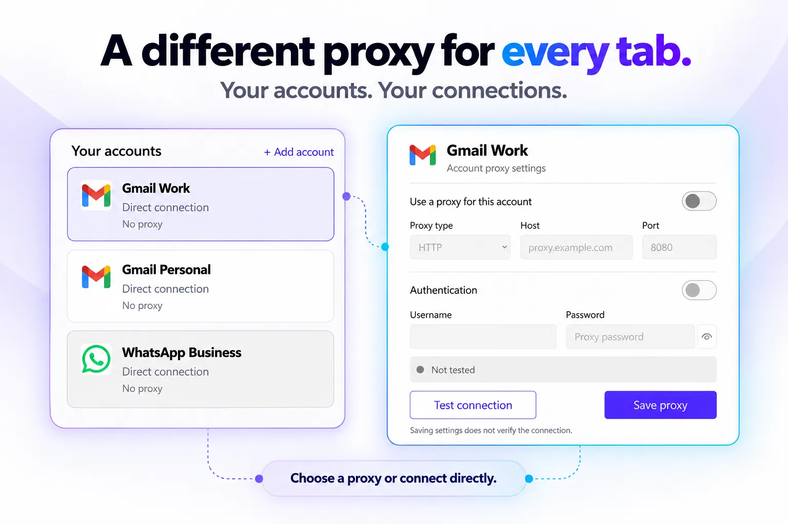
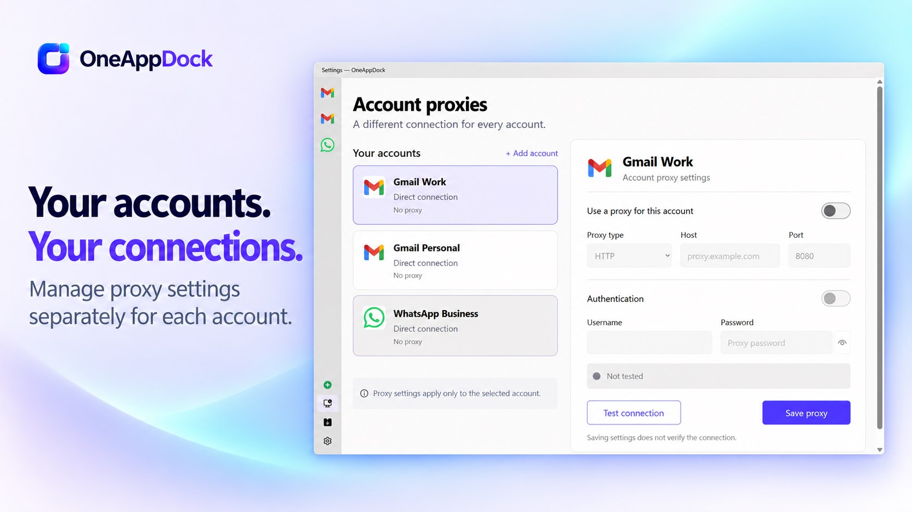
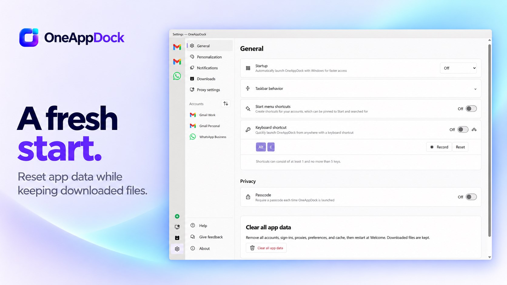
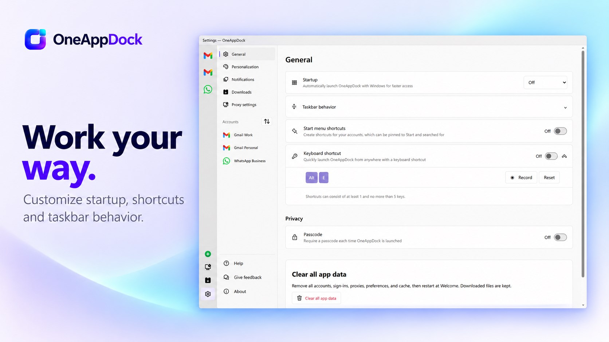
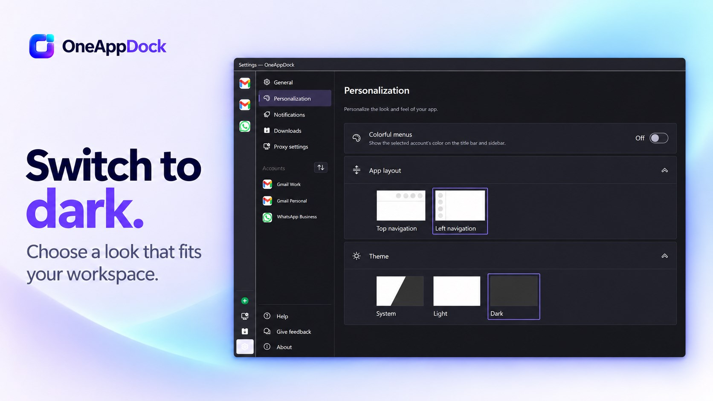
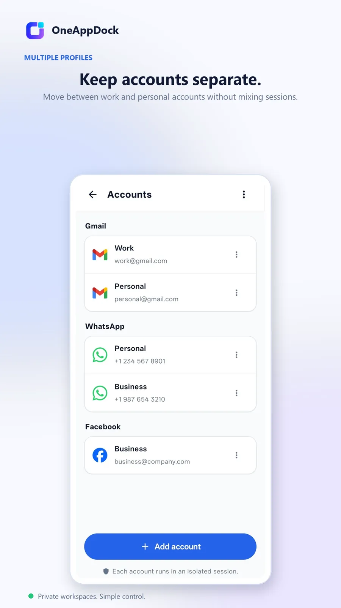
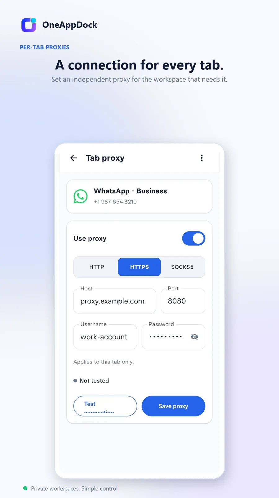
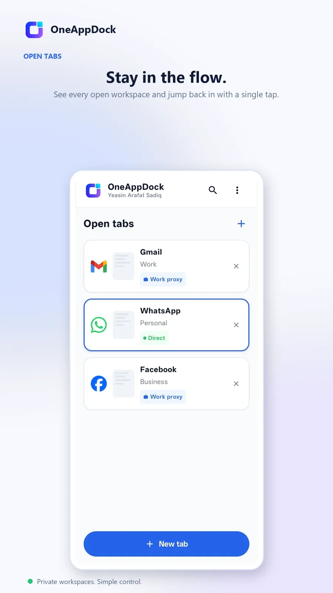
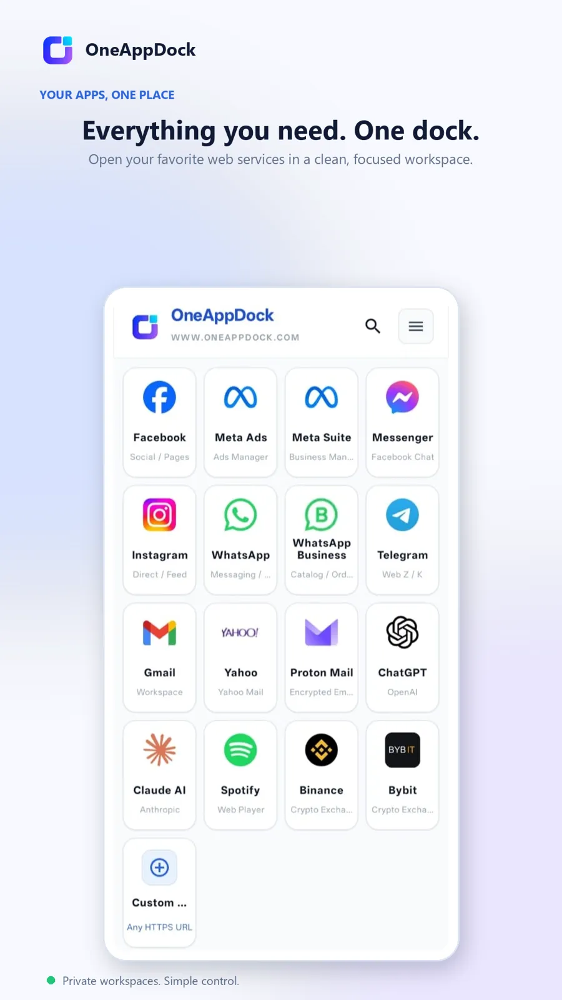

# OneAppDock

### All Your Apps. One Dock.
**Multiple accounts, multiple proxies, zero hassle.**

 

### 🌐 Direct Download from Official Website: [**www.oneappdock.com**](https://www.oneappdock.com/)

[**Windows Installer (.exe)**](https://github.com/sadiqtbh/OneAppDock-Multi-Platform-Version/releases/download/v1.3.4/OneAppDock-Setup-1.3.4-x64.exe) &nbsp;•&nbsp; [**Windows Portable (.exe)**](https://github.com/sadiqtbh/OneAppDock-Multi-Platform-Version/releases/download/v1.3.4/OneAppDock-Portable-1.3.4-x64.exe) &nbsp;•&nbsp; [**macOS (Apple Silicon)**](https://github.com/sadiqtbh/OneAppDock-Multi-Platform-Version/releases/download/v1.3.4/OneAppDock-1.3.4-mac-arm64.zip) &nbsp;•&nbsp; [**macOS (Intel)**](https://github.com/sadiqtbh/OneAppDock-Multi-Platform-Version/releases/download/v1.3.4/OneAppDock-1.3.4-mac-x64.zip) &nbsp;•&nbsp; [**Linux (.deb)**](https://github.com/sadiqtbh/OneAppDock-Multi-Platform-Version/releases/download/v1.3.4/OneAppDock-1.3.4-linux-amd64.deb) &nbsp;•&nbsp; [**Linux (.tar.gz)**](https://github.com/sadiqtbh/OneAppDock-Multi-Platform-Version/releases/download/v1.3.4/OneAppDock-1.3.4-linux-x64.tar.gz) &nbsp;•&nbsp; [**Android APK**](https://apkpure.com/oneappdock/com.oneappdock.app)

---

## 🌟 Overview

**OneAppDock** is a next-generation desktop & mobile productivity workspace that organizes all your web applications, messaging platforms, and separate accounts into a unified, high-performance dock. 

Available across **Windows (Win32 & Microsoft Store)**, **macOS (Apple Silicon & Intel)**, **Linux (Debian/Ubuntu & Tarball)**, and **Android (APK & APKPure)**.

---

## 🛡️ The Core Superpower: One Tab = One Proxy (Per-Account Proxy Isolation)

Traditional web browsers enforce a **single global proxy** across all open windows. If you connect to a proxy for one task, your entire browser is forced through it—slowing down other tabs, triggering CAPTCHAs, or causing security issues.

**OneAppDock completely reinvents proxy routing with Tab-Level & Account-Level Isolation:**

  

- 🌐 **Granular Per-Tab / Per-Account Routing**: Assign an independent **HTTP**, **HTTPS**, or **SOCKS5** proxy to any specific account tab, while your other tabs continue browsing on your high-speed direct connection.
  - *Example*: Tab 1 (Work Gmail) on US corporate proxy ➔ Tab 2 (Client WhatsApp) on UK SOCKS5 proxy ➔ Tab 3 (Notion) on direct ISP connection.
- 🚫 **Zero-Fallback Leak Prevention**: If a proxy disconnects or drops, OneAppDock strictly refuses to route data. It **never** silently falls back to your real IP address, preventing location leaks.
- 🔐 **Windows DPAPI Credential Security**: Proxy passwords and credentials are cryptographically secured using the Windows Data Protection API—never stored in plain text.
- ⚡ **Standalone Connection Testing**: Verify IP address, latency, and proxy health with a single click before applying settings.

---

## 📸 Microsoft Store Showcase (Official Store Listings)

### Unified Workspace & App Multi-Tasking

  

### Paired Split View & Tab Management
*Keep reference documents, chat apps, and email side-by-side with adjustable split geometry.*

  

### Granular Proxy Settings Dialog
*Configure independent HTTP, HTTPS, or SOCKS5 proxies per account.*

  

### High-Contrast Native Dark Mode & Layout Personalization

---

## 📱 Android App Showcase (APKPure Listing)

Experience the same power of isolated accounts, custom proxies, and instant dock navigation on Android smartphones and tablets.

| Multi-Account Drawer | Android Proxies | Tab Switcher | Mobile Overview |
|:---:|:---:|:---:|:---:|
|  |  |  |  |

 

---

## ✨ Features Breakdown

- 👥 **Multiple Isolated Accounts**: Add multiple instances of the same service (e.g. personal Gmail, work Gmail, client WhatsApp). Cookies, sessions, and storage remain strictly separated.
- 🏠 **Universal Home Button**: Instant one-click return to service root (e.g. `facebook.com`, `mail.google.com`).
- 🎙️ **Full WhatsApp Voice Support**: Dedicated media grants, audio device handler, unthrottled background playback, and conditional WebRTC UDP policy.
- 🔔 **Native Windows Notification Focus**: Clicking notifications seamlessly restores and focuses OneAppDock.
- 🧩 **Paired Service Tabs & Split View**: Group companion services together (e.g. Facebook & Messenger, Google & Calendar) and switch or split view with a single click.
- ⚡ **Optimized Native Viewports**: Native window resizing updates bounds smoothly without tearing, flickering, or re-initializing sessions.
- 🎨 **Deep UI Personalization**: Choose between top navigation and left sidebar dock layouts, enable dynamic colorful menus, or choose system / light / dark themes.
- 🧹 **One-Click Privacy & Data Reset**: Clear all cached data, cookies, and profiles anytime in Settings > General with a single confirmation.

---

## 📦 Multi-Platform Downloads

> **Direct website downloads available at: [https://www.oneappdock.com/](https://www.oneappdock.com/)**

| Platform | Package | Description | Download |
| :--- | :--- | :--- | :--- |
| **Windows** | `OneAppDock-Setup-1.3.4-x64.exe` | Standard Windows x64 installer | [Download](https://github.com/sadiqtbh/OneAppDock-Multi-Platform-Version/releases/download/v1.3.4/OneAppDock-Setup-1.3.4-x64.exe) |
| **Windows** | `OneAppDock-Portable-1.3.4-x64.exe` | Portable standalone executable | [Download](https://github.com/sadiqtbh/OneAppDock-Multi-Platform-Version/releases/download/v1.3.4/OneAppDock-Portable-1.3.4-x64.exe) |
| **Windows** | Microsoft Store | Official Certified Store App | [Get from Microsoft](https://apps.microsoft.com/detail/9nsz4xc8zwf3?hl=en-US&gl=BZ) |
| **macOS** | `OneAppDock-1.3.4-mac-arm64.zip` | Apple Silicon (M1/M2/M3/M4) | [Download](https://github.com/sadiqtbh/OneAppDock-Multi-Platform-Version/releases/download/v1.3.4/OneAppDock-1.3.4-mac-arm64.zip) |
| **macOS** | `OneAppDock-1.3.4-mac-x64.zip` | Intel Macs | [Download](https://github.com/sadiqtbh/OneAppDock-Multi-Platform-Version/releases/download/v1.3.4/OneAppDock-1.3.4-mac-x64.zip) |
| **Linux** | `OneAppDock-1.3.4-linux-amd64.deb` | Debian / Ubuntu package | [Download](https://github.com/sadiqtbh/OneAppDock-Multi-Platform-Version/releases/download/v1.3.4/OneAppDock-1.3.4-linux-amd64.deb) |
| **Linux** | `OneAppDock-1.3.4-linux-x64.tar.gz` | Universal Linux Tarball | [Download](https://github.com/sadiqtbh/OneAppDock-Multi-Platform-Version/releases/download/v1.3.4/OneAppDock-1.3.4-linux-x64.tar.gz) |
| **Linux** | `OneAppDock-1.3.4-linux-x64.zip` | Portable Linux Zip | [Download](https://github.com/sadiqtbh/OneAppDock-Multi-Platform-Version/releases/download/v1.3.4/OneAppDock-1.3.4-linux-x64.zip) |
| **Android** | APK Download (v1.0.6) | Mobile application | [Download APK](https://apkpure.com/oneappdock/com.oneappdock.app) |
| **Media Kit** | `OneAppDock-Screenshots.zip` | Full high-res UI screenshots (`1440x960`) | [Download](https://github.com/sadiqtbh/OneAppDock-Multi-Platform-Version/releases/download/v1.3.4/OneAppDock-Screenshots.zip) |

---

## 👨‍💻 Author & Attribution

Developed by **Yeasin Arafat Sadiq**  
- Official Website: [https://www.oneappdock.com/](https://www.oneappdock.com/)
- Microsoft Store: [OneAppDock on Microsoft Store](https://apps.microsoft.com/detail/9nsz4xc8zwf3?hl=en-US&gl=BZ)
- APKPure: [OneAppDock on APKPure](https://apkpure.com/oneappdock/com.oneappdock.app)
- Privacy Policy: [https://www.oneappdock.com/privacy](https://www.oneappdock.com/privacy)

---

### ⚖️ Legal & Trademarks
*OneAppDock is an independent third-party application and is not affiliated, associated, authorized, endorsed by, or in any way officially connected with Google, Meta, WhatsApp, Slack, OpenAI, Microsoft, Apple, or any of their subsidiaries or affiliates. All product names, logos, brands, and registered trademarks belong to their respective owners.*
